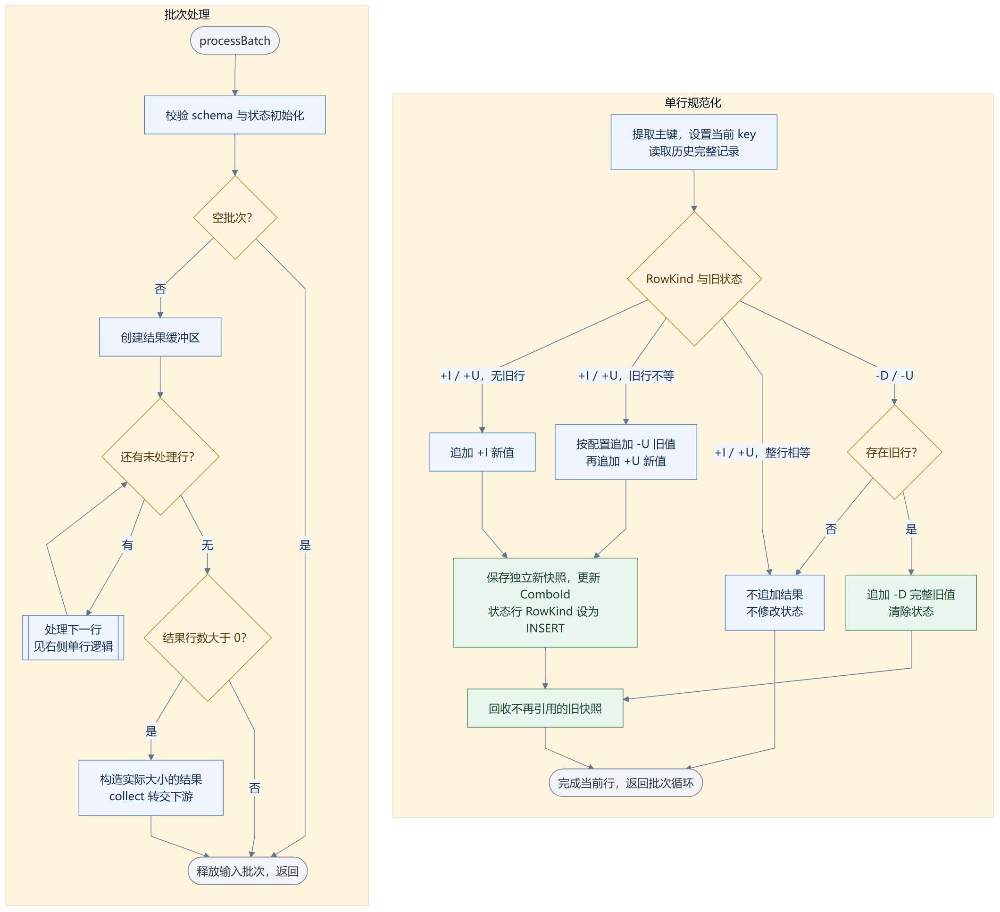
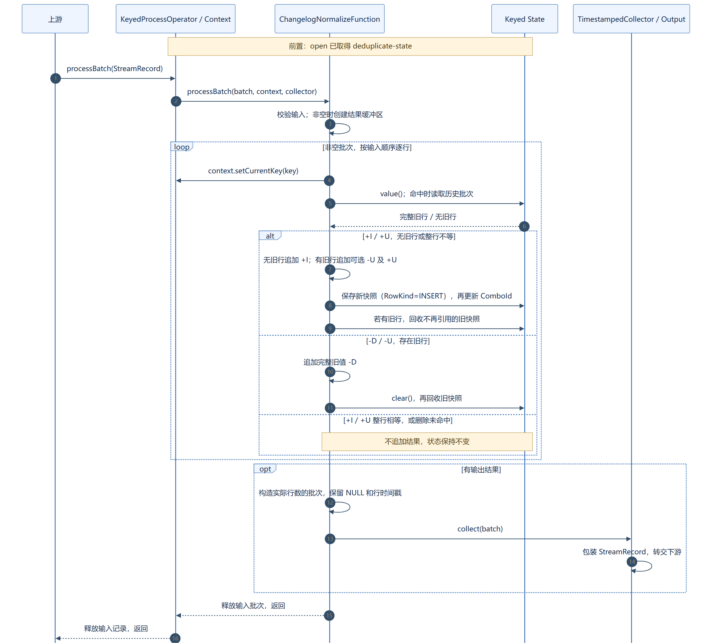
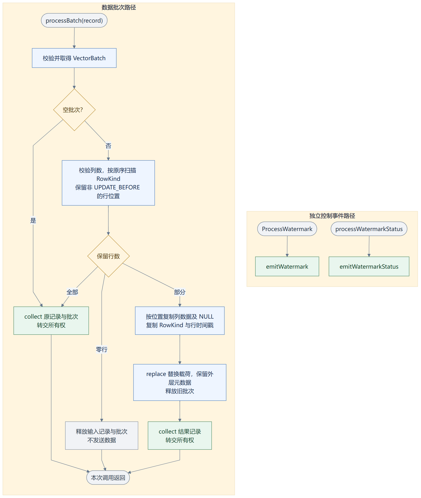
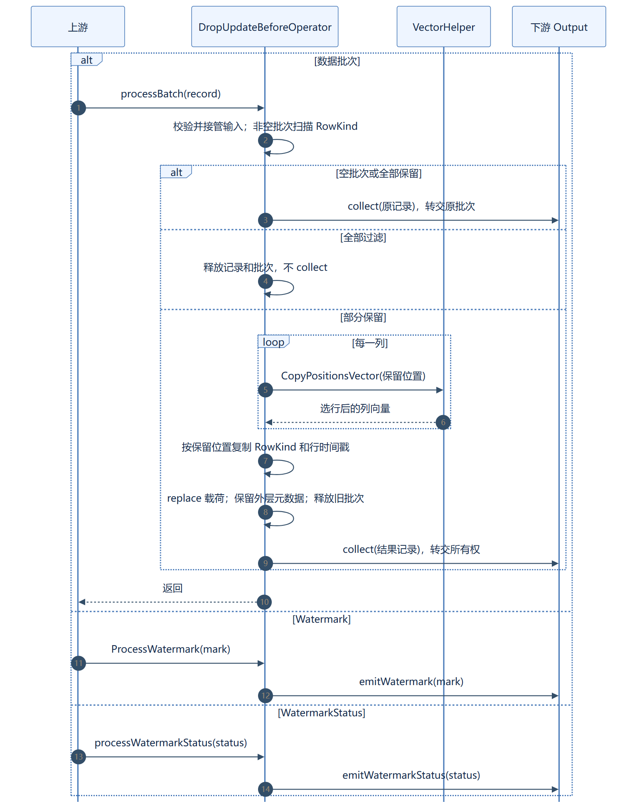
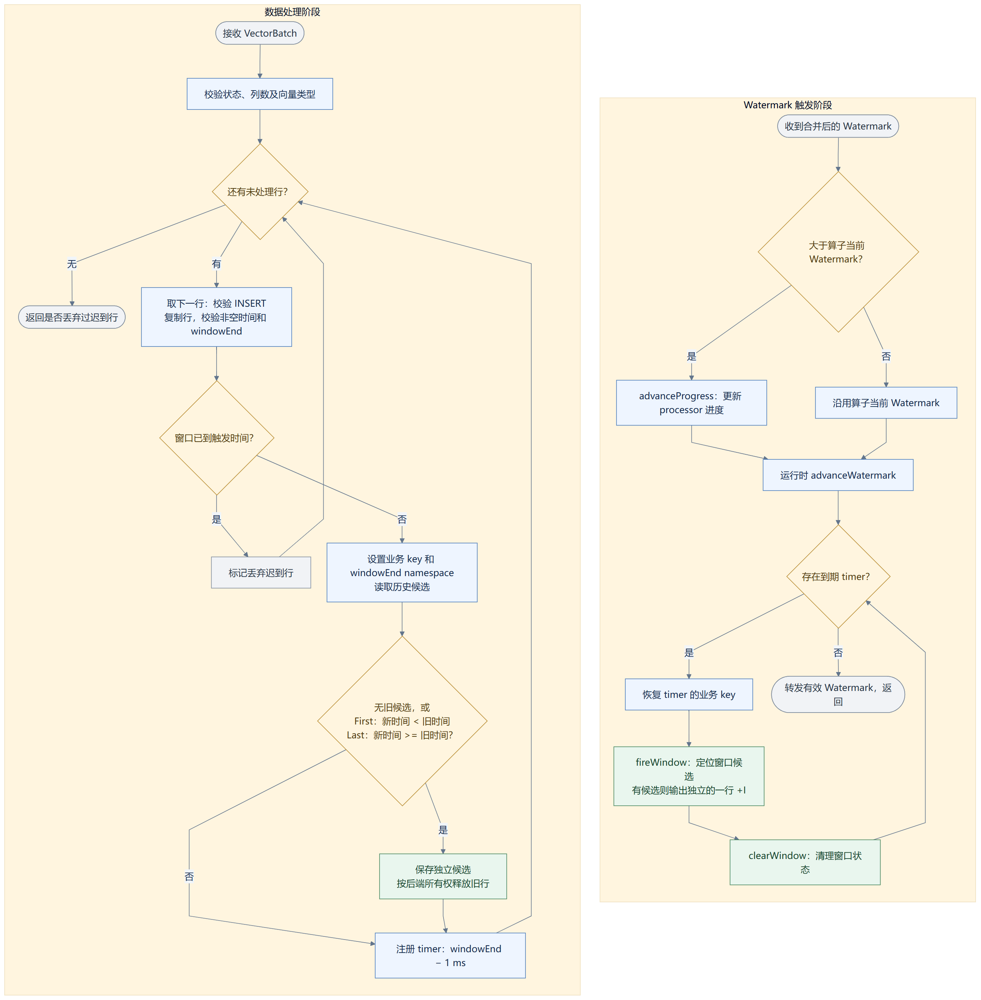
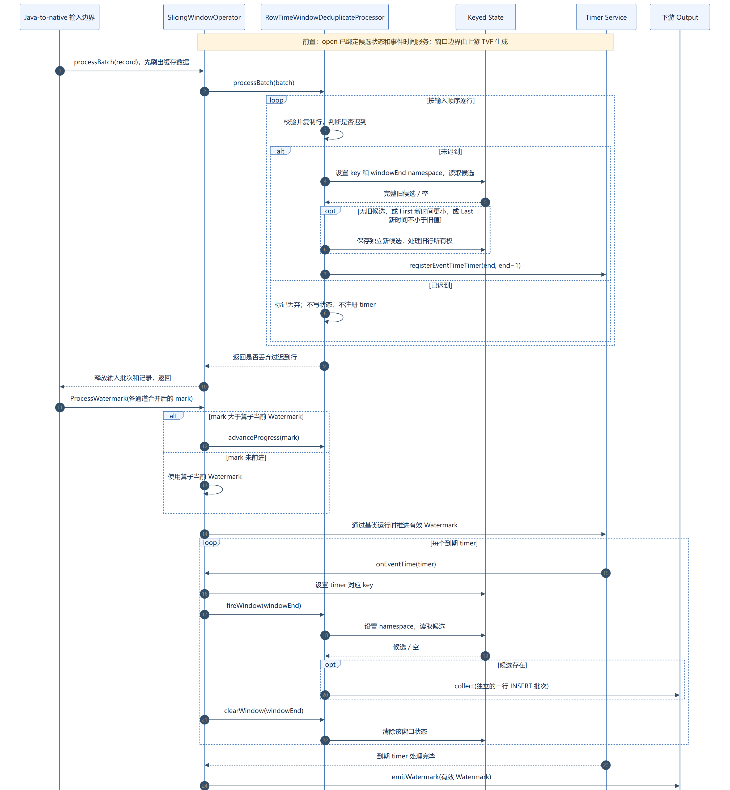

# Native ChangelogNormalize、DropUpdateBefore、WindowDeduplicate 算子设计与测试文档

## 1 支持 ChangelogNormalize native 算子

### 1.1 SR（编号／标题／具体实现内容）

**编号：**（待补充）  
**标题：**支持 ChangelogNormalize native 算子。  
**具体实现内容：**实现 native 变更日志规范化，按主键维护历史记录，生成下游所需的变更事件。

### 1.2 支持 ChangelogNormalize native 算子

**编号：**（待补充）  
**标题：**支持 ChangelogNormalize native 算子。  
**具体实现内容：**处理上游传递的 VectorBatch，完成变更记录规范化和状态更新，并将结果发送给下游算子。

#### 1.2.1 模块说明

在 SQL 任务提交后，Java 侧收集字段类型、主键索引及是否生成 UPDATE_BEFORE 等配置，以 JSON 格式通过 JNI 传递给 native 侧。运行时创建 `KeyedProcessOperator` 和 `ChangelogNormalizeFunction`，通过 `open` 获取状态后端及 `deduplicate-state`，保存各主键对应的历史完整记录。

算子通过 `processBatch` 逐行处理输入。对于 INSERT 或 UPDATE_AFTER，无历史记录时输出 INSERT；存在历史记录且整行不等时，按配置输出旧值 UPDATE_BEFORE 和新值 UPDATE_AFTER，再更新状态。整行比较包含 RowKind、字段值和 NULL，相等时不输出。对于 DELETE 或 UPDATE_BEFORE，有历史记录时输出完整旧值 DELETE 并清除状态，无历史记录时不输出。

同一主键的状态更新立即生效，批次处理结束后将结果组织为 VectorBatch 发给下游。当前支持非 NULL 的单列或复合 BIGINT 主键、Heap／RocksDB 后端，要求关闭 mini-batch、TTL 为 0。

*图：ChangelogNormalize 算子运行流程图。左侧为批次循环，右侧为单行处理；整行比较包含 RowKind、字段和 NULL。+I／-U／+U／-D 对应新增／更新前／更新后／删除。*

#### 1.2.2 模块流程

*图：ChangelogNormalize 算子运行时序图*

#### 1.2.3 模块接口详细设计

#### （1）ChangelogNormalize 算子初始化接口

| 字段 | 参数／内容 | 说明 |
| :--- | :--- | :--- |
| 原型 | `explicit ChangelogNormalizeFunction(const nlohmann::json& config)` |  |
| 功能 | 解析并校验字段类型、主键索引、更新前事件开关及运行配置。 |  |
| 输入 | `config` | 算子配置 JSON |
| 输出 | 函数对象 |  |
| 说明 | 要求输入输出类型一致；不支持的配置明确拒绝。 |  |
| 备注 | 算子创建时调用。 |  |

#### （2）初始化状态接口

| 字段 | 参数／内容 | 说明 |
| :--- | :--- | :--- |
| 原型 | `void open(const Configuration& config) override` |  |
| 功能 | 获取 keyed runtime context 和 deduplicate-state。 |  |
| 输入 | `config` | 生命周期配置 |
| 输出 | 无 |  |
| 说明 | 主状态保存历史行的位置标识，完整行保存在后端管理的批次中。 |  |
| 备注 | 算子生命周期开始时调用。 |  |

#### （3）ChangelogNormalize 算子处理数据接口

| 字段 | 参数／内容 | 说明 |
| :--- | :--- | :--- |
| 原型 | `void processBatch(omnistream::VectorBatch* input, Context& ctx, TimestampedCollector& out) override` |  |
| 功能 | 按主键规范化输入变更、更新状态并输出结果。 |  |
| 输入 | `input` | 上游数据批次 |
| 输入 | `ctx` | 当前 key 上下文 |
| 输入 | `out` | 结果收集器 |
| 输出 | 无返回值，通过 collect 发送结果。 |  |
| 说明 | 按输入顺序逐行处理，单条输入最多生成两条输出。 |  |
| 备注 | 算子运行时调用。 |  |

#### 1.2.4 测试设计

#### ChangelogNormalize 测试用例表

SQL 用例使用 Kafka Debezium JSON 输入，声明 BIGINT 主键并开启 `table.exec.source.cdc-events-duplicate`；检查计划和目标算子日志，确认 ChangelogNormalize 由 native 执行。

| 序号 | 测试维度 | 测试用例 | 预期结果 |
| :---: | :--- | :--- | :--- |
| 1 | 变更记录规范化 | 运行包含 ChangelogNormalize 的 SQL，输入同一主键的新增、更新、删除和删除后重插记录，与原生 Flink 对比。 | 输出事件类型、字段值和同主键事件顺序与原生 Flink 一致。 |
| 2 | 重复变更记录 | 运行相同 SQL，重放 CDC 更新消息；通过 UT 补充重复 INSERT 和同值 UPDATE_AFTER。 | 重复 INSERT 被抑制；同值 UPDATE_AFTER 按 RowKind 语义处理，结果与原生 Flink 一致。 |
| 3 | 支持 RocksDB 状态后端 | 配置项 `state.backend` 设为 `rocksdb`，运行变更规范化 SQL，与原生 Flink 对比。 | 输出变更事件与原生 Flink 一致。 |
| 4 | 支持内存状态后端 | 配置项 `state.backend` 设为 `hashmap`，分别以并行度 1、2 运行相同 SQL，与原生 Flink 对比。 | 各主键的输出事件序列及重复次数与原生 Flink 一致。 |
| 5 | 类型与状态边界 | 通过 UT 验证支持类型及 NULL、复合 BIGINT 主键、跨批更新、删除未命中和更新前事件开关。 | 字段复制和状态隔离正确；删除未命中不输出，UPDATE_BEFORE 按配置生成。 |

---

## 2 支持 DropUpdateBefore native 算子

### 2.1 SR（编号／标题／具体实现内容）

**编号：**（待补充）  
**标题：**支持 DropUpdateBefore native 算子。  
**具体实现内容：**实现 native UPDATE_BEFORE 记录过滤，保留其他变更记录。

### 2.2 支持 DropUpdateBefore native 算子

**编号：**（待补充）  
**标题：**支持 DropUpdateBefore native 算子。  
**具体实现内容：**处理上游传递的 VectorBatch，过滤 UPDATE_BEFORE，并将保留的记录发送给下游算子。

#### 2.2.1 模块说明

在 SQL 任务提交后，Java 侧收集输入输出类型并生成 JSON 描述，经校验后由 native 工厂创建 `DropUpdateBeforeOperator`。该算子无状态，不使用主键，也不配对 UPDATE_BEFORE 和 UPDATE_AFTER。

算子通过 `processBatch` 扫描每行 RowKind，记录非 UPDATE_BEFORE 的行位置。全部保留时直接转发原批次，全部过滤时释放输入且不输出，部分保留时调用 `VectorHelper::CopyPositionsVector` 复制选中行，再构造结果批次发送给下游。

保留行的字段、NULL、RowKind 和时间戳保持不变，行顺序保持不变。空批次直接透传，Watermark 和 WatermarkStatus 通过独立接口原样转发。

*图：DropUpdateBefore 算子运行流程图。数据批次与控制事件通过独立入口处理；全过滤不阻断控制事件。*

#### 2.2.2 模块流程

*图：DropUpdateBefore 算子运行时序图*

#### 2.2.3 模块接口详细设计

#### （1）DropUpdateBefore 算子初始化接口

| 字段 | 参数／内容 | 说明 |
| :--- | :--- | :--- |
| 原型 | `DropUpdateBeforeOperator(const nlohmann::json& description, Output* output)` |  |
| 功能 | 校验配置、保存列数并绑定结果输出器。 |  |
| 输入 | `description` | 算子配置 JSON |
| 输入 | `output` | 结果输出器 |
| 输出 | 算子对象 |  |
| 说明 | 输入输出类型一致，不创建状态或定时器。 |  |
| 备注 | 算子创建时调用。 |  |

#### （2）DropUpdateBefore 算子处理数据接口

| 字段 | 参数／内容 | 说明 |
| :--- | :--- | :--- |
| 原型 | `void processBatch(StreamRecord* record) override` |  |
| 功能 | 过滤 UPDATE_BEFORE，保留其他记录。 |  |
| 输入 | `record` | 载荷为 VectorBatch 的输入记录 |
| 输出 | 无返回值，通过 Output::collect 发送结果。 |  |
| 说明 | 覆盖全保留、全过滤和部分保留三条路径，保持剩余行顺序及元数据。 |  |
| 备注 | 算子运行时调用。 |  |

#### （3）控制事件处理接口

| 字段 | 参数／内容 | 说明 |
| :--- | :--- | :--- |
| 原型 | `void ProcessWatermark(Watermark* watermark) override` / `void processWatermarkStatus(WatermarkStatus* status) override` |  |
| 功能 | 透传水位线及水位线状态。 |  |
| 输入 | `watermark` / `status` | 上游控制事件 |
| 输出 | 无返回值，通过对应 Output 接口转发。 |  |
| 说明 | 数据全部过滤时仍正常转发控制事件。 |  |
| 备注 | 收到对应控制事件时调用。 |  |

#### 2.2.4 测试设计

#### DropUpdateBefore 测试用例表

SQL 用例采用 Kafka CDC → DropUpdateBefore → ChangelogNormalize 链路，通过目标算子日志及处理计数确认 native 过滤生效，独立 UT 检查过滤后的记录。

| 序号 | 测试维度 | 测试用例 | 预期结果 |
| :---: | :--- | :--- | :--- |
| 1 | 更新前记录过滤 | 运行包含 DropUpdateBefore 的 CDC SQL，输入新增、更新和删除消息，与原生 Flink 对比；通过 UT 检查四种 RowKind 的混合输入。 | 仅过滤 UPDATE_BEFORE，其他记录不变；SQL 输出与原生 Flink 一致。 |
| 2 | 批次边界 | 通过 UT 输入全部保留、全部过滤和空批次，并将 UPDATE_BEFORE、UPDATE_AFTER 分批发送。 | 全保留和空批透传，全过滤无输出；跨批不缓存、不配对。 |
| 3 | 数据完整性 | 通过 UT 验证支持类型、NULL、字典／常量字符串及行级、外层时间戳。 | 保留行的字段、NULL、RowKind、时间戳和顺序不变。 |
| 4 | 控制事件透传 | 通过 UT 在数据全部过滤后发送 Watermark 和 WatermarkStatus。 | 控制事件原样到达下游，不受数据过滤影响。 |

---

## 3 支持 WindowDeduplicate native 算子

### 3.1 SR（编号／标题／具体实现内容）

**编号：**（待补充）  
**标题：**支持 WindowDeduplicate native 算子。  
**具体实现内容：**实现事件时间窗口去重，按业务 key 和窗口保留最早或最晚的一条记录。

### 3.2 支持 WindowDeduplicate native 算子

**编号：**（待补充）  
**标题：**支持 WindowDeduplicate native 算子。  
**具体实现内容：**实现 TUMBLE、HOP、CUMULATE 窗口内的 First／Last 去重，窗口触发时将最终结果发送给下游算子。

#### 3.2.1 模块说明

在 SQL 任务提交后，Java 侧收集业务 key、排序时间列、窗口结束时间列、First／Last 和窗口种类等配置，通过 JNI 传递给 native 侧。窗口边界由上游 Java Window TVF 生成，native 侧在 `SlicingWindowOperator` 下创建 `RowTimeWindowDeduplicateProcessor`，通过 `open` 初始化状态后端和事件时间定时服务。

运行时，`processBatch` 按业务 key 和 window-end namespace 保存完整候选行。First 仅在新记录时间更小时替换，时间相同保留先到记录；Last 在新记录时间大于或等于旧记录时替换，时间相同保留后到记录。已关闭窗口的迟到记录直接丢弃，未关闭窗口注册 `windowEnd−1 ms` 的事件时间定时器。

Watermark 推进后，定时器回调触发 `fireWindow`，将候选记录组织为一行 INSERT 批次输出，再由 `clearWindow` 清理状态。Java-to-native 输入边界先刷出缓存数据，再推进合并后的 Watermark。当前支持 INSERT 输入、event-time TIMESTAMP(3)、UTC/Z 时区及 BIGINT 业务 key。

*图：WindowDeduplicate 算子运行流程图。数据阶段循环维护候选，Watermark 阶段循环触发到期窗口；当前 UTC/Z 下，普通有限窗口在进度达到 windowEnd−1 ms 时视为已触发。*

#### 3.2.2 模块流程

*图：WindowDeduplicate 算子运行时序图*

#### 3.2.3 模块接口详细设计

#### （1）WindowDeduplicate 算子初始化接口

| 字段 | 参数／内容 | 说明 |
| :--- | :--- | :--- |
| 原型 | `RowTimeWindowDeduplicateProcessor(const nlohmann::json& config, Output* output)` |  |
| 功能 | 解析类型、业务 key、时间列、窗口种类和 First／Last 配置。 |  |
| 输入 | `config` | 算子配置 JSON |
| 输入 | `output` | 结果输出器 |
| 输出 | 处理器对象 |  |
| 说明 | 校验事件时间语义、字段类型和索引。 |  |
| 备注 | 算子创建时调用。 |  |

#### （2）状态与定时服务初始化接口

| 字段 | 参数／内容 | 说明 |
| :--- | :--- | :--- |
| 原型 | `void open(AbstractKeyedStateBackend<KeyType>* backend, const nlohmann::json& config, StreamingRuntimeContext<KeyType>* runtimeContext, InternalTimerServiceImpl<KeyType, int64_t>* timerService) override` |  |
| 功能 | 初始化 window_deduplicate 状态及事件时间定时服务。 |  |
| 输入 | `backend` | keyed 状态后端 |
| 输入 | `config` / `runtimeContext` | 配置及运行时上下文 |
| 输入 | `timerService` | 事件时间定时服务 |
| 输出 | 无 |  |
| 说明 | KeyType 为 std::shared_ptr<RowData>；窗口 namespace 为 Long 类型。 |  |
| 备注 | 算子生命周期开始时调用。 |  |

#### （3）WindowDeduplicate 算子处理数据接口

| 字段 | 参数／内容 | 说明 |
| :--- | :--- | :--- |
| 原型 | `bool processBatch(omnistream::VectorBatch* batch) override` |  |
| 功能 | 选择窗口候选、写入状态并注册事件时间定时器。 |  |
| 输入 | `batch` | 已附带窗口边界的输入批次 |
| 输出 | `bool` | 是否丢弃过迟到记录 |
| 说明 | 按业务 key 和窗口隔离状态，不产生中间更新结果。 |  |
| 备注 | 算子运行时调用。 |  |

#### （4）窗口触发与清理接口

| 字段 | 参数／内容 | 说明 |
| :--- | :--- | :--- |
| 原型 | `void fireWindow(int64_t windowEnd) override` / `void clearWindow(int64_t windowEnd) override` |  |
| 功能 | 输出窗口最终候选，并清理对应窗口状态。 |  |
| 输入 | `windowEnd` | 窗口结束时间 |
| 输出 | 无返回值，通过 collect 发送 INSERT 结果。 |  |
| 说明 | 包装算子先恢复 timer 对应 key，再依次调用 fireWindow 和 clearWindow。 |  |
| 备注 | 事件时间定时器触发时调用。 |  |

#### （5）水位线推进接口

| 字段 | 参数／内容 | 说明 |
| :--- | :--- | :--- |
| 原型 | `void advanceProgress(long progress) override` |  |
| 功能 | 更新当前水位线进度，用于迟到判断。 |  |
| 输入 | `progress` | 当前水位线时间戳 |
| 输出 | 无 |  |
| 说明 | 进度单调推进，定时器触发由外层运行时负责。 |  |
| 备注 | 收到新的 Watermark 时调用。 |  |

#### 3.2.4 测试设计

#### WindowDeduplicate 测试用例表

SQL 使用 Window TVF 与 `ROW_NUMBER()`，按业务 key、window_start、window_end 分组并过滤 `rownum=1`。检查计划和 `WindowDeduplicate native processor opened` 日志，确认目标算子由 native 执行。

| 序号 | 测试维度 | 测试用例 | 预期结果 |
| :---: | :--- | :--- | :--- |
| 1 | TUMBLE 窗口 First 去重 | 运行 TUMBLE 窗口 SQL，按事件时间 ASC 取 rownum=1，输入乱序、多 key 和多窗口数据，并覆盖无业务 key 场景。 | 每个 key／窗口保留最早记录，无业务 key 时每窗口保留一条；结果与原生 Flink 一致。 |
| 2 | TUMBLE 窗口 Last 去重 | 运行 TUMBLE 窗口 SQL，按事件时间 DESC 取 rownum=1，与原生 Flink 对比。 | 每个 key／窗口保留最晚记录，结果与原生 Flink 一致。 |
| 3 | HOP 窗口 First 去重 | 运行步长 5 秒、大小 10 秒的 HOP 窗口 SQL，按事件时间 ASC 取 rownum=1。 | 各窗口独立保留最早记录，结果与原生 Flink 一致。 |
| 4 | CUMULATE 窗口 Last 去重 | 运行步长 5 秒、最大窗口 10 秒的 CUMULATE 窗口 SQL，按事件时间 DESC 取 rownum=1。 | 各累计窗口独立保留最晚记录，结果与原生 Flink 一致。 |
| 5 | 支持 RocksDB 状态后端 | 配置项 `state.backend` 设为 `rocksdb`，以并行度 1、2 运行 TUMBLE Last SQL。 | 输出与原生 Flink 一致。 |
| 6 | 支持内存状态后端 | 配置项 `state.backend` 设为 `hashmap`，以并行度 1、2 运行上述窗口去重 SQL。 | 输出与原生 Flink 一致，窗口正常触发和清理。 |
| 7 | 选行与触发边界 | 通过 UT 验证相同事件时间、跨批候选、复合／NULL key、支持类型及 NULL；推进 Watermark 关闭窗口后再输入迟到记录。 | 同时间 First 保留先到、Last 保留后到；状态隔离且数据完整，窗口只输出一次，迟到记录不重新产生结果。 |
